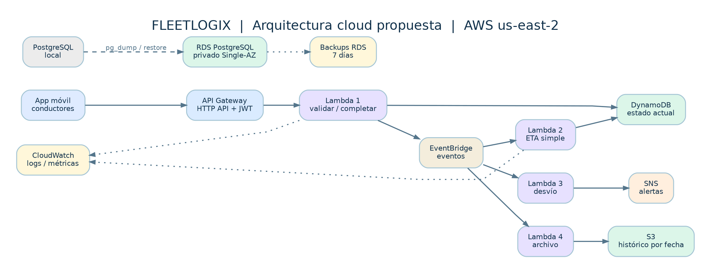

# FleetLogix — Avance 4: arquitectura Cloud AWS

**Fecha:** 18 de noviembre de 2026  
**Alcance:** diseño académico + demostración funcional local, **sin despliegue AWS**.  
**Región propuesta:** `us-east-2` (Ohio), en coherencia con Snowflake FleetLogix.  
**Objetivo:** arquitectura explicable y presupuesto teórico **menor a US$50/mes**.

## 1. Flujo en tiempo real

1. El conductor emite `POST /events` por HTTPS. **API Gateway HTTP API** verifica JWT (Cognito u otro emisor OIDC) y limita solicitudes.
2. **Lambda 1 (`lambda_ingest`)** valida `event_id`, entrega, estado y fecha; determina si está `delivered` y guarda **estado actual** en DynamoDB. Responde 202. `GET /deliveries/{id}` consulta ese estado: esta es la funcionalidad de actualización casi inmediata.
3. Lambda 1 publica un evento `DeliveryEvent` en **EventBridge**, que distribuye el mensaje a tres Lambdas: ETA, desvíos y archivo.
4. **Lambda 2 (`lambda_eta`)** calcula un ETA ilustrativo = kilómetros restantes / velocidad media, y actualiza DynamoDB.
5. **Lambda 3 (`lambda_route_alert`)** calcula distancia al waypoint de referencia y publica un aviso en **SNS** si supera 2 km. No es navegación real ni cálculo de distancia a la ruta completa.
6. **Lambda 4 (`lambda_archive`)** conserva el evento en **S3** como `events/AAAA/MM/DD/event_id.json`. S3 = histórico; DynamoDB = estado reciente.
7. **CloudWatch** registra métricas y errores; las alarmas notifican a SNS. Los servicios invocan roles IAM de privilegio mínimo.

**Contrato de API:** `POST /events`, `GET /deliveries/{id}`. Respuestas JSON. La demo local comprueba POST->estado->GET, ETA, desvío, archivo y deduplicación.

## 2. Responsabilidad de servicios

| Servicio | Elección y justificación |
|---|---|
| API Gateway HTTP API | Entrada HTTPS con autorización JWT, costo bajo y rutas sencillas |
| AWS Lambda (4) | Funciones pequeñas sin servidores dedicados; escala por eventos |
| EventBridge | Desacopla procesamiento de ETA, alertas y archivo |
| DynamoDB | Lectura/escritura rápida del estado actual por `delivery_id` |
| S3 | Conserva JSON histórico, organizado por fecha y con cifrado SSE-S3 |
| RDS PostgreSQL | Propuesta de traslado de tablas relacionales actuales y backups administrados |
| SNS | Notificación de desvíos y alarmas críticas |
| CloudWatch | Logs estructurados, indicadores y alarmas |

**Separación RDS/DynamoDB:** RDS albergaría el histórico operacional relacional migrado; la API móvil utiliza DynamoDB en el camino crítico para no acoplar cada evento a RDS. La sincronización eventual de eventos hacia RDS sería una **extensión futura**, no una característica implementada.

## 3. Migración PostgreSQL local -> RDS (procedimiento propuesto)

- Crear instancia **RDS PostgreSQL privada**, `db.t4g.micro`, **Single-AZ**, gp3 20 GiB, cifrado al crear, SSL/TLS y grupo de seguridad restringido.
- Programar ventana de migración; respaldar con `pg_dump -Fc` de `fleetlogix_db`, crear destino y restaurar con `pg_restore` desde una estación con conexión autorizada (túnel temporal/VPN).
- Validar las seis tablas operacionales (vehicles, drivers, routes, trips, deliveries, maintenance), constraints, conteos y consultas clave. No introducir RDS pública ni un bastión permanente solamente para la entrega.
- Cambiar la cadena de conexión **solo tras validación**. Mantener copia local de respaldo. RDS con backups automáticos **7 días** y prueba periódica de recuperación.
- **No ejecutado:** no se provisionaron RDS, redes ni restauraciones reales.

## 4. Monitoreo y alertas

| Indicador | Alerta propuesta | Motivo |
|---|---|---|
| API Gateway `5xx`, latencia p95 | 5xx > 5 por 5 min; p95 > 2 s | Fallos y experiencia móvil |
| Lambda `Errors`, `Throttles`, duración | Error > 1 % en 5 min | Eventos que no se procesan |
| DynamoDB `ThrottledRequests` | > 0 en 5 min | Estado no actualizado |
| RDS `CPUUtilization`, `FreeStorageSpace` | CPU > 80 % por 15 min; disco < 2 GiB | Saturación / continuidad |
| Desvío de ruta > 2 km | Evento SNS por entrega | Respuesta operativa |
| S3 / eventos archivados vs recibidos | Diferencia en conteos al cierre diario | Detectar eventos faltantes |

Retención de logs 14 días; no registrar direcciones de clientes, tokens ni coordenadas precisas en logs. Alarmas -> SNS/email de operaciones. Configurar un presupuesto AWS de US$40/mes y aviso al 80 %.

## 5. Seguridad y copias

- **IAM:** usar identidad personal IAM Identity Center o usuario IAM no root, MFA; roles Lambda separados por función, con permisos `dynamodb`, `events:PutEvents`, `s3:PutObject` o `sns:Publish` limitados a recursos específicos. No almacenar credenciales AWS en código.
- **API:** authorizer JWT, HTTPS, validación de payload, throttling y control de tamaño.
- **Cifrado:** RDS at rest (KMS, habilitado desde creación); DynamoDB cifrado por defecto; S3 SSE-S3, Block Public Access; TLS en tránsito.
- **Backups:** RDS automatizados 7 días, restauración documentada; versionado y retención S3 según requisitos; PITR DynamoDB opcional, no incluido en presupuesto.
- **Aislamiento:** RDS en subred privada, sin IPv4 público; las Lambdas del flujo principal no requieren VPC ni NAT Gateway. Acceso a RDS solamente durante tareas administradas de migración o mantenimiento.

## 6. Presupuesto mensual teórico

**Escenario:** 50.000 eventos y solicitudes API al mes; 200.000 invocaciones Lambda (fan-out), 5 GB S3, 20 GiB RDS SSD, una única RDS `db.t4g.micro` encendida 730 h, menos de 1 GB DynamoDB, logs bajos, sin cargas masivas de salida. **No se aplican créditos ni descuentos Free Tier.**

| Partida | USD/mes |
|---|---:|
| RDS PostgreSQL, instancia | 11.68 |
| RDS PostgreSQL, SSD gp3 | 2.30 |
| Backups RDS | 0.00 |
| API Gateway HTTP | 0.05 |
| AWS Lambda | 0.30 |
| DynamoDB | 0.30 |
| Amazon S3 | 0.37 |
| EventBridge | 0.05 |
| SNS | 0.05 |
| CloudWatch | 2.00 |
| Transferencia | 1.00 |
| Contingencia | 5.00 |
| **TOTAL PROYECTADO** | **23.10** |

**Advertencia:** presupuesto ilustrativo, no cotización ni factura. Puede superar US$50 con Multi-AZ, NAT Gateway, bastión siempre encendido, AWS DMS, secretos administrados, alta transferencia, uso real superior o copias extra. Recalcular en [AWS Pricing Calculator](https://calculator.aws/) y activar AWS Budgets **antes** de desplegar.

## 7. Evidencia de implementación académica y límites

Se entregan cuatro handlers Lambda con llamadas `boto3` preparadas, y una simulación local que prueba actualización de estado casi inmediata, ETA, alerta, archivo y deduplicación. Ningún recurso AWS fue creado y ninguna aplicación móvil real fue conectada.

En un despliegue real, las escrituras DynamoDB y la publicación EventBridge no son transaccionales en conjunto; se requiere patrón outbox, reintentos y reconciliación. El detector de desvío a waypoint y ETA simplificado son **aproximaciones educativas**. La disponibilidad de RDS Single-AZ no está garantizada ante fallos de zona.

## Fuentes de referencia

- AWS RDS: https://aws.amazon.com/rds/postgresql/pricing/
- AWS Lambda: https://aws.amazon.com/lambda/pricing/
- AWS HTTP API: https://aws.amazon.com/api-gateway/pricing/
- AWS DynamoDB: https://aws.amazon.com/dynamodb/pricing/
- AWS S3: https://aws.amazon.com/s3/pricing/
- AWS CloudWatch: https://aws.amazon.com/cloudwatch/pricing/
- AWS Pricing Calculator: https://calculator.aws/
- AWS API Gateway JWT: https://docs.aws.amazon.com/apigateway/latest/developerguide/http-api-jwt-authorizer.html
- AWS RDS backups: https://docs.aws.amazon.com/AmazonRDS/latest/gettingstartedguide/managing-backup-restore.html
