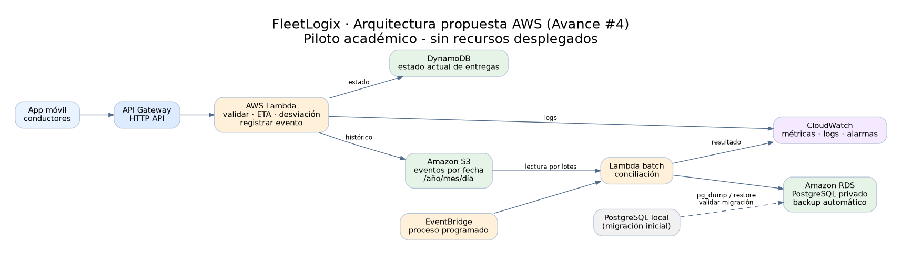

# FleetLogix — Avance #4 · Diseño de arquitectura AWS

**Alcance:** propuesta académica sin despliegue de recursos. Región de referencia `us-east-2` (Ohio), una sola AZ para limitar costos; no es diseño de alta disponibilidad productiva.

## Diagrama

## Flujo de datos

1. Aplicación móvil de conductor envía evento HTTPS autenticado a **API Gateway HTTP API**.
2. **Lambda** valida esquema, id y fecha, verifica entrega completada, calcula ETA ilustrativo o marca desvío sobre un waypoint de referencia.
3. **DynamoDB** mantiene el estado actual por entrega (lecturas rápidas); **S3** guarda cada evento original como JSON bajo `events/YYYY/MM/DD/event_id.json`.
4. **EventBridge** dispara una Lambda batch periódica que consolida nuevos eventos en **RDS PostgreSQL** privado, manteniendo la BD operacional como registro transaccional.
5. **CloudWatch** recibe métricas, logs y alarmas. RDS activa backups automáticos, cifrado en reposo y acceso restringido.

**Advertencia:** DynamoDB y S3 no forman una transacción distribuida. Para uso real se necesitaría control de reintentos, deduplicación por `event_id` mediante escritura condicional y reconciliación de fallos parciales. Ejemplo Lambda entregado es demostrativo, no production ready.

## Funciones Lambda (4 muestras)

- `check_delivery_completed`: verifica identidad, estado y fecha.
- `estimate_eta`: distancia restante / velocidad media (modelo simple, no ML).
- `detect_route_deviation`: distancia a waypoint, no desvío geométrico real a toda la ruta.
- `validate_event`: esquema y normalización temporal de un evento.

`Scripts/Avance_4/test_lambda_logic.py` las prueba **sin conectar a AWS**.

## Migración y base de datos

- Migración planeada: `pg_dump` desde PostgreSQL local -> restauración controlada en **RDS for PostgreSQL**, validación de conteos, restricciones y rendimiento; ventana de corte y rollback documentadas. No se ha migrado la BD real.
- RDS Single-AZ privado, 20 GiB SSD, cifrado administrado, backups automáticos (p.ej. 7 días), acceso desde funciones autorizadas en VPC.
- DynamoDB: clave de partición `delivery_id`, atributo `event_id`, estado, timestamp y ubicación aproximada; TTL solo para datos transitorios si aplica.
- S3: cifrado SSE-S3, bloqueo de acceso público, versionado según retención deseada y política de ciclo de vida.

## IAM y seguridad

- Nunca usar usuario root; roles de IAM separados para Lambda API, Lambda batch y auditoría.
- Permisos mínimos por recurso: escritura solamente en tabla DynamoDB y prefijo S3 correspondiente; batch con lectura S3 y acceso limitado a RDS.
- API Gateway con autorización JWT/Cognito (diseño), validación de entradas, cuotas y throttling.
- Secrets Manager para contraseña RDS, no variables de entorno en texto.
- CloudWatch Logs con retención explícita; sin PII en logs operativos.

## Monitoreo

- `APIGateway 4XXError/5XXError/Latency` -> advertencias si crecen fallas o latencia.
- `Lambda Errors/Throttles/Duration` -> alertas por fallos y tiempos de ejecución.
- `DynamoDB ThrottledRequests` y errores de escritura -> alertas de capacidad.
- `RDS CPUUtilization/FreeStorageSpace/DatabaseConnections` -> alertas operativas.
- Evento de desvío mayor a 2 km, entrega atrasada o fallo de conciliación -> métricas personalizadas.
- CloudWatch Alarm -> SNS/email autorizado (diseño).

## Presupuesto teórico mensual (USD, escenario de laboratorio)

**Supuestos:** 100.000 eventos al mes, Lambda 128 MB/250 ms, DynamoDB menos de 1 GB, S3 5 GB, RDS PostgreSQL `db.t4g.micro` Single-AZ encendida 730 horas y 20 GiB. Sin NAT Gateway, load balancer, Multi-AZ ni grandes transferencias externas. Tarifas orientativas; las variables dependen de región, impuestos, backups, acceso a red y créditos Free Tier.

| Recurso | Supuesto | Estimado USD/mes |
|---|---|---:|
| RDS instancia | db.t4g.micro, 730 h × $0.016 | 11.68 |
| RDS almacenamiento y backup adicional | 20 GiB SSD y margen | 3.50 |
| API Gateway HTTP API | 0.1 millones de solicitudes | 0.10 |
| Lambda | 0.1 millones, 128 MB/250 ms | 0.25 |
| DynamoDB | lecturas/escrituras+1 GB | 1.00 |
| S3 | 5 GB + solicitudes | 0.30 |
| CloudWatch, SNS, Secrets Manager | bajo volumen | 3.00 |
| Transferencia/variación | reserva académica | 5.00 |
| **TOTAL ESTIMADO** | **sin descuentos Free Tier** | **24.83** |

**Restricción solicitada: US$50/mes.** Este escenario teórico **cabe debajo del límite**, pero no es un presupuesto garantizado. Recalcular con [AWS Pricing Calculator](https://calculator.aws/) antes de desplegar. Un NAT Gateway o Multi-AZ podrían romper el límite.

Fuentes: [RDS](https://aws.amazon.com/rds/postgresql/pricing/), [Lambda](https://aws.amazon.com/lambda/pricing/), [API Gateway](https://aws.amazon.com/api-gateway/pricing/), [DynamoDB](https://aws.amazon.com/dynamodb/pricing/), [S3](https://aws.amazon.com/s3/pricing/).

## Estado

Incluidos: arquitectura documentada, diagrama editable y PNG, 4 funciones y pruebas offline, controles y costos teóricos. **No incluido:** aprovisionamiento real de recursos AWS, migración efectiva de PostgreSQL, eventos reales ni puesta en servicio. La consigna del avance prioriza comprender y documentar el diseño.
